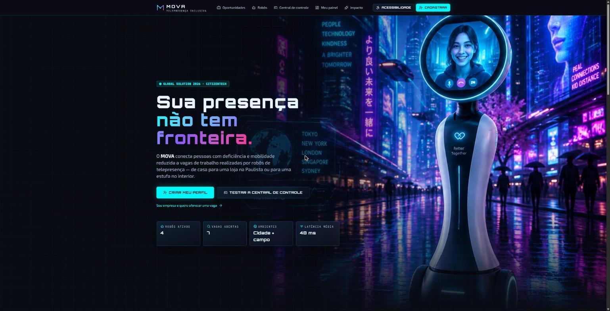
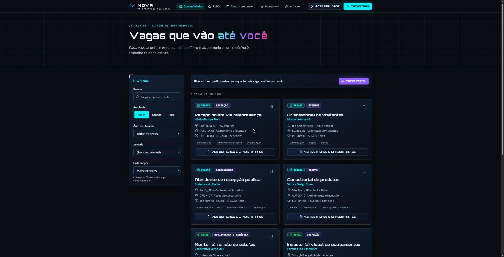
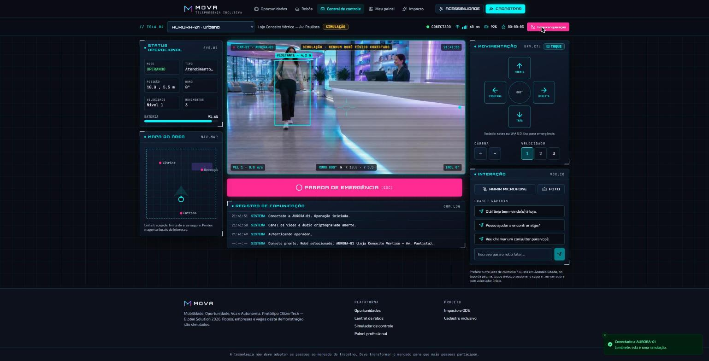
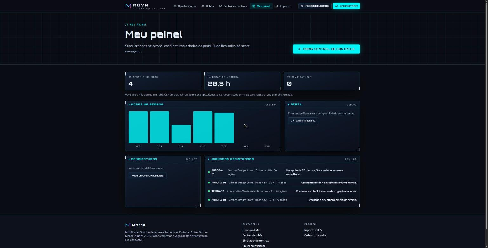
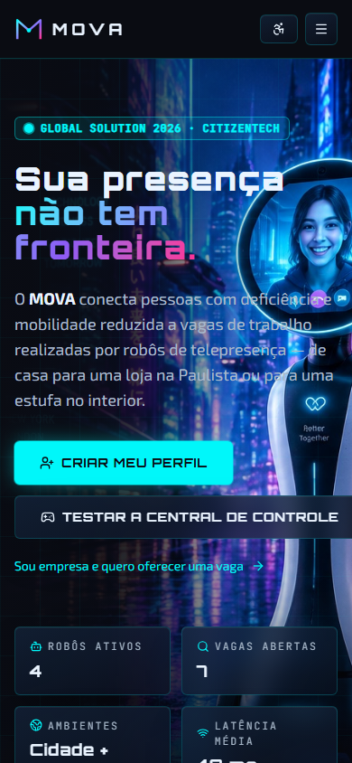

# MOVA — Sua presença não tem fronteira

**Mobilidade, Oportunidade, Voz e Autonomia.** Plataforma web que liga pessoas com deficiência ou mobilidade reduzida a vagas de trabalho feitas por robôs de telepresença. A pessoa fica em casa e controla, à distância, um robô numa loja, museu, prefeitura, estufa ou fazenda.

Protótipo do desafio **CitizenTech — Global Solution 2026**. Robôs, empresas e vagas são simulados.

**Site:** https://mova-nine-alpha.vercel.app · **Especificação:** [docs/especificacao.md](docs/especificacao.md) · **Vídeo Pitch:** https://youtu.be/3OH0aJraCqw?feature=shared.



## O problema

| Indicador                                    | Valor                                | Fonte                             |
| -------------------------------------------- | ------------------------------------ | --------------------------------- |
| Pessoas com deficiência no Brasil            | 18,6 milhões                         | IBGE, PNAD Contínua 2022          |
| Participação na força de trabalho            | 29,2% (contra 66,4% sem deficiência) | IBGE, PNAD Contínua 2022          |
| Vivem longe de vagas com deslocamento diário | 2 em 3                               | Estimativa ilustrativa do projeto |

Falta de rampa, transporte inacessível e distância dos centros deixam muita gente fora do mercado. O MOVA leva a presença profissional até a vaga. Inspiração: Dawn Avatar Robot Café, em Tóquio. O MOVA é uma opção a mais, nunca substituto de ambientes acessíveis.

## Quem usa e a jornada

- **Profissional com deficiência ou mobilidade reduzida:** escolhe vaga, ambiente e jornada; usa controle adaptado (teclado, toque, pressionar e segurar, varredura) e pausas.
- **Empresa parceira:** contrata além do raio de deslocamento, com operação monitorada e parada de emergência.

Jornada: **Home → Cadastro (3 etapas) → Oportunidades (filtrar e ordenar por compatibilidade) → Candidatura → Treino no simulador → Jornada registrada no painel.**

## Telas

| Rota             | Tela                | O que faz                                                                  |
| ---------------- | ------------------- | -------------------------------------------------------------------------- |
| `/`              | Home                | Produto, números, como funciona, benefícios, cidade e campo                |
| `/cadastro`      | Cadastro            | Profissional em 3 etapas ou empresa (`?perfil=empresa`, valida CNPJ)       |
| `/oportunidades` | Oportunidades       | 7 vagas, filtros, compatibilidade, candidatura                             |
| `/robos`         | Central de robôs    | Frota de 5 robôs com ficha técnica                                         |
| `/controle`      | Central de controle | Simulador (`?robo=aurora-01`) com câmera, mapa, log e parada de emergência |
| `/painel`        | Meu painel          | Jornadas, horas, candidaturas e perfil                                     |
| `/impacto`       | Impacto             | Números, ODS 8, 9 e 10, jornada do usuário                                 |

| Oportunidades                                | Central de controle                | Painel                         |
| -------------------------------------------- | ---------------------------------- | ------------------------------ |
|  |  |  |

## Como o JavaScript melhora a experiência

- Filtros e busca de vagas atualizam a lista e o contador na hora, ignorando acentos.
- Compatibilidade de 0 a 100 entre perfil e vaga (70% habilidades, 30% área), com ordenação.
- Cadastro em etapas com validação por campo e mensagens claras; dá para voltar sem perder dados.
- Simulador: máquina de estados do robô (conectar, mover, limite da área segura, bateria), teclado (setas, WASD, Esc), varredura com acionador único e registro de comunicação.
- Perfil, candidaturas, jornadas e preferências de acessibilidade salvos no navegador (`localStorage`).

## Acessibilidade e responsividade

- Menu **Acessibilidade** em todas as telas: tamanho do texto, alto contraste, fonte de alta legibilidade (Atkinson Hyperlegible), menos animação, alvos maiores e modo de controle do robô.
- Link "pular para o conteúdo", navegação completa por teclado e foco visível.
- Estado de conexão e alertas também em texto, não só por cor.
- Texto alternativo nas imagens e gráficos com descrição para leitor de tela.
- Layout para celular, tablet e desktop, com controles por toque.



## Tecnologia e organização

TanStack Start (React 19, SSR), TypeScript, Tailwind CSS 4, shadcn/ui (Radix), Vitest. Deploy na Vercel.

```
src/
  routes/       uma rota por arquivo
  components/   mova/ (produto), controle/ (simulador), ui/ (base)
  lib/          dados fictícios, regras puras e testes
  assets/       imagens
docs/           especificação, design e plano
```

## Como rodar

Requer Node.js >= 22.12.

```bash
npm install
npm run dev      # http://localhost:3000
npm test         # regras de vagas, cadastro, simulador e painel
npm run build
```

## Integrantes

| Nome                         | RM       |
| ---------------------------- | -------- |
| Amanda Ayumi Guedes Ueno     | RM573609 |
| Ana Rubia de Oliveira Freire | RM573171 |
| Francisco Caetano Bernardes  | RM571399 |
| Giovana Camargo Budin        | RM571861 |

## Origem

Protótipo iniciado no Lovable e finalizado neste repositório. 
